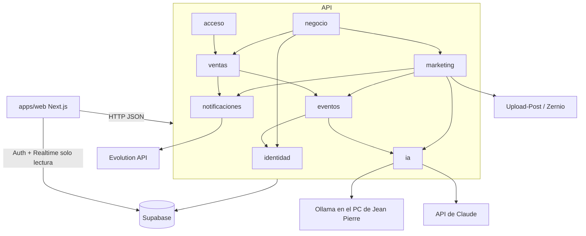
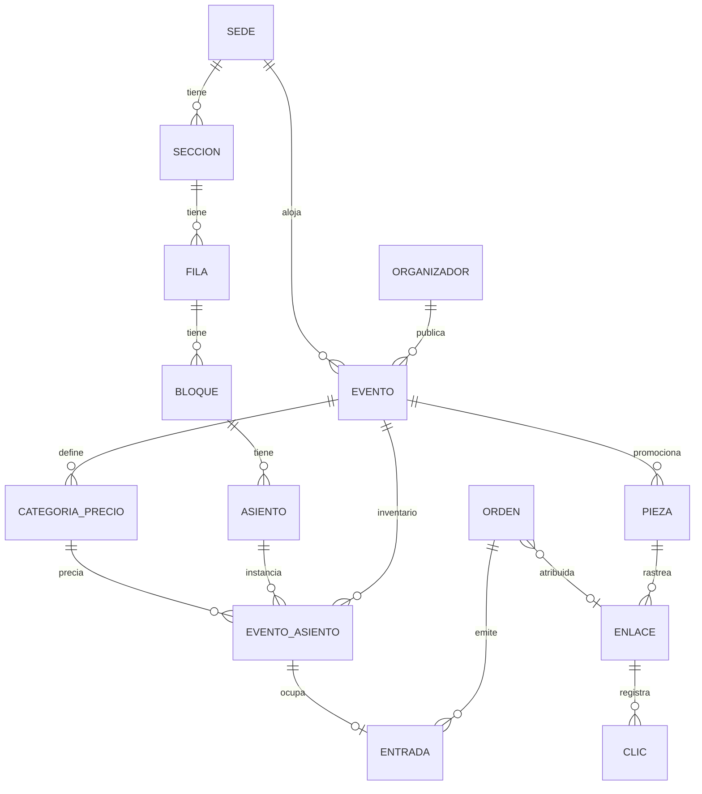
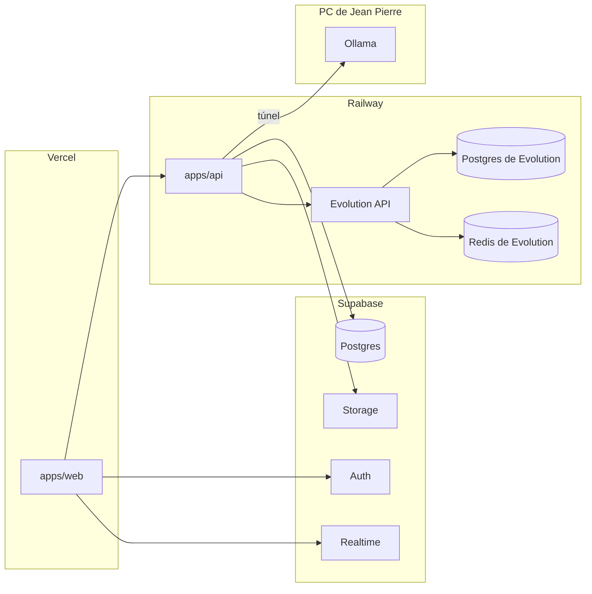

# Arquitectura base: plataforma de eventos culturales de Piura

## Paradigma de diseño

**Monolito modular.** Una sola API NestJS, con un módulo por contexto de negocio, y una web Next.js que la consume. Cada módulo es dueño de sus tablas y expone un servicio. Ningún módulo lee ni escribe las tablas de otro.

| Módulo (`apps/api/src/<módulo>`) | Dueño de |
|---|---|
| `identidad` | Perfiles y roles |
| `eventos` | Sedes, mapa (sección, fila, bloque, asiento), eventos, categorías de precio, aprobación |
| `ventas` | Inventario de asientos por evento, órdenes, pagos, entradas, configuración de comisión |
| `acceso` | Validación de QR y sincronización sin conexión |
| `marketing` | Piezas, campañas, enlaces rastreables, clics, Weekend, publicación en redes |
| `negocio` | Liquidaciones, tablero y exportación (la configuración de comisión es de `ventas`, AD-10) |
| `notificaciones` | Bandeja de salida de WhatsApp y envío por Evolution API |
| `ia` | Adaptador único del proveedor de IA |

## Invariantes y reglas



### AD-1: Solo la API escribe en la base de datos

- **Binds:** all
- **Prevents:** reglas de negocio (aforo, aprobación, comisión) duplicadas o saltadas desde el cliente.
- **Rule:** La web usa Supabase solo para **Auth** (inicio de sesión y JWT) y para **Realtime de solo lectura** del estado de las butacas. Todo lo demás pasa por la API. RLS deniega las escrituras a los roles `anon` y `authenticated`, y la única lectura que permite es `SELECT` sobre el estado de `ventas_evento_asientos`. La API usa la clave de servicio y valida el JWT de Supabase en cada petición.

### AD-2: Cada módulo es dueño de sus tablas

- **Binds:** all
- **Prevents:** dos epics que modifican la misma tabla con reglas distintas.
- **Rule:** La dependencia entre módulos sigue el diagrama y nunca va al revés. Un módulo accede a los datos de otro solo a través del servicio exportado de ese otro. Cada tabla lleva el prefijo de su módulo (`eventos_`, `ventas_`, …). Las dependencias que el diagrama no recoge se añaden aquí antes de usarlas.

### AD-3: Un rol por cuenta [ADOPTED]

- **Binds:** CAP-1
- **Prevents:** permisos mezclados entre roles.
- **Rule:** `identidad_perfiles.rol` ∈ `admin | organizador | publico`, uno por cuenta. Lo comprueba un guard de NestJS (`@Roles()`). La web solo oculta lo que no corresponde al rol, y nunca es la que da el permiso.

### AD-4: El mapa es de la sede; el inventario, del evento

- **Binds:** CAP-2, CAP-5, CAP-15, CAP-16
- **Prevents:** que un evento cambie el mapa de otro, o precios que se pisan entre eventos de la misma sede.
- **Rule:**
  - La jerarquía `sede → sección → fila → bloque → asiento` pertenece a `eventos`. Una sección es `numerada` (con asientos) o `general` (con capacidad).
  - Las categorías de precio (nombre, color y precio) son **del evento**.
  - El inventario lo crea `ventas` con `asegurarInventario(evento_id)`, que es idempotente y se llama al primer acceso de venta o de mapa de un evento aprobado. Por cada asiento crea un `ventas_evento_asientos` con su categoría, y un cupo por cada sección general. `eventos` nunca llama a `ventas`.
  - La pizarra (CAP-15) y la IA (CAP-16) solo editan el mapa de la sede.
  - Si una sede tiene algún evento aprobado, su mapa ya no se edita: para cambiarlo, se duplica la sede.

### AD-5: El bloqueo y el aforo son atómicos en Postgres

- **Binds:** CAP-5, CAP-15
- **Prevents:** la misma butaca vendida dos veces, o más entradas que el aforo.
- **Rule:**
  - Estados del asiento: `disponible → bloqueado (expira_en = ahora + 10 min) → vendido`. La transición se hace con **un único `UPDATE … WHERE estado='disponible' OR expira_en < now()`**, y se comprueban las filas afectadas.
  - El cupo de una sección general se descuenta con un `UPDATE` condicional (`vendidas + n <= capacidad`).
  - No se usan Redis ni bloqueos en memoria.
  - La venta se rechaza si `now() >= evento.inicio`.

### AD-6: La entrada se emite solo con el pago confirmado

- **Binds:** CAP-5, CAP-6
- **Prevents:** entradas emitidas con pagos que no se completaron.
- **Rule:**
  - Estados de la orden: `pendiente → pagada | expirada`. La orden `pendiente` vence a la vez que sus bloqueos, y un pago que llega después del vencimiento se rechaza y se anula en la pasarela.
  - El pago pasa por la interfaz `PasarelaPago` de `ventas`. Para la demo solo existe la implementación **simulada**: tarjeta, Yape o Plin, sin cargo real y sin pedir datos reales de tarjeta.
  - El paso a `pagada` lo hace solo `ventas`, en el servidor, cuando `PasarelaPago` confirma. Eso marca los asientos como `vendido`, crea las `ventas_entradas` y encola el envío de WhatsApp.
  - Una pasarela real futura entra como otra implementación de `PasarelaPago`, con checkout alojado, para que los datos de tarjeta nunca pasen por la API.

### AD-7: QR firmado y validación de un solo uso

- **Binds:** CAP-6, CAP-7
- **Prevents:** QR falsificados, o un mismo QR aceptado dos veces.
- **Rule:**
  - El QR contiene `entrada_id.firma`, donde la firma es HMAC-SHA256 con `QR_SECRET`.
  - **En línea:** se hace `UPDATE ventas_entradas SET usada_en=now() WHERE id=? AND usada_en IS NULL`; si no se actualiza ninguna fila, la entrada se rechaza.
  - **Sin conexión:** la app de puerta descarga el manifiesto del evento (identificadores y estado) en IndexedDB, valida la firma y marca la entrada en local, y guarda una cola de sincronización. Al sincronizar, gana el primer uso que llega a la API, y los conflictos se registran.
  - Solo `acceso` escribe `usada_en`.

### AD-8: Enlace rastreable con atribución al último clic

- **Binds:** CAP-9, CAP-10, CAP-11, CAP-14
- **Prevents:** que marketing y negocio cuenten las ventas por campaña de forma distinta.
- **Rule:**
  - El enlace tiene la forma `https://<web>/r/:codigo`, con un código base62 de 8 caracteres en `marketing_enlaces`, que guarda evento, pieza o campaña, red y zona.
  - La web llama a `marketing` para registrar el clic y redirige al evento con `?ref=:codigo`. La web conserva `ref` en la sesión hasta el pago.
  - `ventas` guarda `ref` en la orden, sin validarlo.
  - Las métricas por pieza se calculan uniendo `ventas_ordenes.ref` con `marketing_enlaces.codigo`. Solo `negocio` y `marketing` hacen esa unión, y la leen a través del servicio de `ventas`.

### AD-9: WhatsApp solo por la bandeja de salida

- **Binds:** CAP-6, CAP-9, CAP-14
- **Prevents:** varios clientes de Evolution API con números o formatos distintos, o un fallo de WhatsApp que rompe una compra.
- **Rule:**
  - Solo `notificaciones` llama a Evolution API. Los demás módulos llaman a `notificaciones.encolar({telefono, plantilla, datos, adjunto_url?})`.
  - Un proceso de envío reintenta hasta 3 veces y marca `enviado | fallido`.
  - El teléfono se guarda en formato E.164 (`+51…`).
  - Un envío fallido nunca revierte la operación que lo originó.

### AD-10: Dinero en céntimos y la comisión congelada en la orden

- **Binds:** CAP-5, CAP-12, CAP-13
- **Prevents:** errores de redondeo, o liquidaciones que cambian al modificar la comisión.
- **Rule:**
  - Los importes son enteros en céntimos de PEN.
  - Los precios incluyen el IGV del 18 %.
  - La configuración vigente vive en `ventas_config_comision`, cuyo dueño es `ventas`. `negocio` la cambia solo a través del servicio de `ventas`.
  - Al pagarse la orden se guardan `comision_modelo`, `comision_valor` y `comision_importe` vigentes en ese momento.
  - La liquidación suma esos valores congelados, nunca los recalcula.

### AD-11: La IA solo pasa por `ia` y nunca escribe datos de venta

- **Binds:** CAP-3, CAP-8, CAP-14, CAP-16
- **Prevents:** varios proveedores o formatos de respuesta, o fechas y precios inventados en las piezas.
- **Rule:**
  - `ia` expone funciones con entrada y salida tipadas (zod), cada una con su tiempo límite y su respuesta de respaldo: `textosYCampaña`, `alertaApdayc`, `leerCroquis` y `weekend`.
  - Ruta de proveedores: `textosYCampaña`, `alertaApdayc` y `weekend` van a **Ollama**, que corre en el PC de Jean Pierre y se alcanza por un túnel (`OLLAMA_URL`). `leerCroquis` va a la **API de Claude** (`claude-sonnet-5-5`). Cambiar de proveedor solo toca `ia`.
  - En las piezas, la IA devuelve solo textos, paleta y campaña. Fecha, sede y precio vienen siempre del evento.
  - `leerCroquis` devuelve una propuesta de mapa que solo se guarda cuando el organizador la confirma en la pizarra.

### AD-12: Las piezas se renderizan con plantillas, no se generan como imagen

- **Binds:** CAP-8, CAP-9, CAP-14
- **Prevents:** piezas con datos erróneos y formatos que no coinciden entre la web y la publicación.
- **Rule:**
  - Hay una plantilla JSX por familia de formato (`9x16`, `4x5`, `16x9`, `a4`) en `apps/web/app/piezas/[pieza]/[formato]/route.tsx`, con `next/og`. Lee los datos de la pieza desde la API y devuelve un PNG.
  - Cuando `marketing` publica en redes, usa ese PNG por URL.
  - El formato A4 incluye el QR del enlace rastreable.

## Convenciones de consistencia

| Tema | Convención |
|---|---|
| Idioma del dominio | Español en tablas, campos, rutas y DTO (`eventos`, `orden`, `butaca`); inglés solo en lo técnico de las librerías |
| Tablas y columnas | `snake_case`, con el prefijo del módulo (AD-2) |
| Identificadores | UUID v4. Excepción: el código del enlace (AD-8) |
| Fechas | `timestamptz` en UTC; se muestran en `America/Lima` |
| Contrato HTTP | REST JSON bajo `/api/v1/<módulo>/…`. Error: `{ "error": { "codigo": "BUTACA_NO_DISPONIBLE", "mensaje": "…" } }` |
| Tipos compartidos | Esquemas zod en `packages/shared`, que importan la API y la web. Una sola fuente por cada DTO |
| Validación | NestJS 12 con esquemas zod (Standard Schema) en `@Body`, `@Query` y `@Param` |
| Configuración | Variables de entorno; `.env.example` versionado y `.env` ignorado. Sin claves en el código |
| Migraciones | SQL en `supabase/migrations`, una por historia que cambie el esquema. Datos de demo en `supabase/seed.sql` |
| Respaldo por dependencia externa | Cada llamada a pasarela, IA, WhatsApp o redes tiene tiempo límite, y la interfaz muestra la alternativa de la spec |

## Stack

| Nombre | Versión |
|---|---|
| Node.js | 22 LTS |
| pnpm (monorepo con workspaces) | 9.x |
| TypeScript | 5.x |
| Next.js (App Router, React) | ≥ 16.3.3 |
| NestJS | 12.x |
| zod | 4.x |
| Supabase (Postgres, Auth, Storage, Realtime) | Plan gratuito |
| Evolution API (Docker, con su Postgres y su Redis) | v2.x |
| Ollama (textos, campaña, Weekend, alerta de APDAYC) | Versión estable más reciente; el modelo lo elige Jean Pierre |
| API de Claude (lectura del croquis) | `claude-sonnet-5-5` |
| Publicación en redes | Upload-Post o Zernio, plan gratuito `[ASSUMPTION]` |
| Docker Compose | 2.x |
| Railway (API y Evolution API) | Plan Hobby: 5 USD/mes, incluye 5 USD de uso |
| Vercel (web) | Plan Hobby, gratis |

## Semilla estructural

```text
/
  apps/
    web/          # Next.js: público, organizador, administrador, puerta (PWA), plantillas de piezas
    api/          # NestJS: un módulo por contexto (ver Paradigma)
  packages/
    shared/       # esquemas zod y tipos de DTO compartidos
  supabase/
    migrations/   # SQL por historia
    seed.sql      # sede de ejemplo (croquis de insumos/), eventos y ventas sembradas
  docker-compose.yml  # api + evolution-api (+ su postgres y su redis) para local y respaldo
  .env.example
```





**Entornos:** local con `docker compose` y Supabase en la nube, y producción en Vercel, Railway Hobby y Supabase. Railway Hobby es un espacio de un solo desarrollador: la cuenta y el despliegue desde GitHub los lleva Jean Pierre. No hay entorno de pruebas intermedio. El PC con Ollama y el túnel tienen que estar encendidos durante la demo; si fallan, `ia` devuelve las respuestas de respaldo. El respaldo de la demo es `docker compose up` en el portátil de Jean Pierre, apuntando al mismo Supabase.

## Mapa de capacidades a arquitectura

| Capacidad | Vive en | Gobernada por |
|---|---|---|
| CAP-1 | `identidad`, web | AD-1, AD-3 |
| CAP-2, CAP-3 | `eventos`, `ia` | AD-4, AD-11 |
| CAP-4 | `eventos`, web | AD-1 |
| CAP-5 | `ventas` | AD-5, AD-6, AD-10 |
| CAP-6 | `ventas`, `notificaciones` | AD-6, AD-7, AD-9 |
| CAP-7 | `acceso`, web (PWA de puerta) | AD-7 |
| CAP-8 | `marketing`, `ia`, web (plantillas) | AD-11, AD-12 |
| CAP-9 | `marketing`, `notificaciones` | AD-9, AD-12 |
| CAP-10, CAP-11 | `marketing`, `ventas` | AD-8 |
| CAP-12, CAP-13 | `negocio` | AD-8, AD-10 |
| CAP-14 | `marketing`, `ia` | AD-8, AD-9, AD-11, AD-12 |
| CAP-15 | `eventos` (mapa), `ventas` (butacas), web (pizarra) | AD-4, AD-5 |
| CAP-16 | `eventos`, `ia` | AD-4, AD-11 |

## Diferido

- **Componentes de interfaz, estilo y librería de UI:** cada epic los elige. No afectan a los contratos.
- **Librería de la pizarra y del mapa** (SVG o Konva): la elige el epic de compra. AD-4 fija los datos que usa.
- **Librerías de QR y del escáner:** las elige el epic de compra. AD-7 fija el contenido y la validación.
- **Modelo concreto de Ollama:** lo elige y lo prueba Jean Pierre en su PC. Debe escribir bien en español y, si la alerta de APDAYC usa la imagen, tener visión.
- **Herramienta de túnel** (Cloudflare Tunnel o ngrok): la elige quien monte la IA.
- **Prompts de la IA:** los define el epic de marketing. AD-11 fija sus entradas y salidas.
- **Observabilidad y alertas:** no las necesita la demo. Basta con los logs de Railway.
- **Escalado, cachés y CDN:** fuera de alcance para la hackathon.
- **Si hace falta otro alojamiento:** si el consumo supera el crédito incluido, se paga la diferencia o se pasa a un VPS, sin cambiar AD-1 a AD-12.
